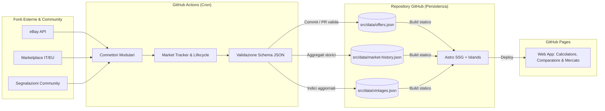

# Architecture Decision Records (ADR) & Master Task Backlog — v.i.n.o.

Questa cartella raccoglie gli **Architecture Decision Records (ADR)** e il **Backlog Operativo** del progetto **v.i.n.o.** (valutazione e comparazione delle "annate" di smartphone nuovi ma mai usati, pubblicato su GitHub Pages), consolidando le decisioni architetturali, di sicurezza e di prodotto.

---

## Indice degli ADR

| ID | Titolo | Stato | Priorità | Autori / Fonti |
| :--- | :--- | :--- | :--- | :--- |
| **[ADR-0001](./0001-core-architecture.md)** | Architettura Core, Stack Tecnologico (Astro + GitHub Pages) e Modello Dati | Proposto | **P1 — Alta** | Dany |
| **[ADR-0002](./0002-data-pipeline-security.md)** | Sicurezza Pipeline Dati, Validazione Input e Hardening GitHub Pages | Proposto | **P0 — Critica** | Dany |
| **[ADR-0003](./0003-market-tracking-persistence.md)** | Persistenza Offerte e Market Tracking Git-Backed | Proposto | **P1 — Alta** | Dany |

---

## Diagramma Architetturale del Sistema

---

## Master Task Backlog (Tutti i Task Censiti)

> **Nota:** Lo stato live (`Open` / `Closed`) di ciascun task è tracciato sulle **GitHub Issues** del repository. Usa `closes #<NumeroIssue>` nei commit per chiuderle automaticamente.

| Task ID | Issue | ADR | Titolo Task | File Coinvolti | Priorità | Assegnatari |
| :--- | :--- | :--- | :--- | :--- | :--- | :--- |
| **TASK-CORE-01** | `#1` | [ADR-0001](./0001-core-architecture.md) | Inizializzazione progetto Astro + TypeScript e deploy GitHub Pages | `package.json`, `astro.config.mjs`, `.github/workflows/deploy-pages.yml` | **P1 — Alta** | Dany |
| **TASK-CORE-02** | `#2` | [ADR-0001](./0001-core-architecture.md) | Definizione schema dati "Annate" (`vintages.json`) e dataset iniziale | `src/schemas/vintage.ts`, `src/data/vintages.json` | **P1 — Alta** | Dany |
| **TASK-CORE-03** | `#3` | [ADR-0001](./0001-core-architecture.md) | Sviluppo Calcolatore e Comparatore di "Annate" interattivo | `src/components/VintageCalculator.astro`, `src/lib/scoring.ts` | **P1 — Alta** | Dany |
| **TASK-DATA-01** | `#4` | [ADR-0001](./0001-core-architecture.md) | Pipeline GitHub Actions per aggiornamento periodico dati statici | `scripts/update_vintages.py`, `.github/workflows/update-data.yml` | **P2 — Media** | Dany |
| **TASK-SEC-01** | `#5` | [ADR-0002](./0002-data-pipeline-security.md) | Hardening validazione dati esterni, sanitizzazione UI e permessi GitHub Actions | `.github/workflows/*.yml`, `src/schemas/vintage.ts` | **P0 — Critica** | Dany |
| **TASK-MKT-01** | `#6` | [ADR-0003](./0003-market-tracking-persistence.md) | Schema persistenza offerte (`offers.json`), serie storica e motore lifecycle/deduplicazione | `src/schemas/offer.ts`, `src/data/offers.json`, `scripts/market_tracker.py` | **P1 — Alta** | Dany |
| **TASK-MKT-02** | `#7` | [ADR-0003](./0003-market-tracking-persistence.md) | Connettori modulari multi-fonte (eBay API, marketplace IT/EU, community) | `scripts/connectors/*.py` | **P1 — Alta** | Dany |
| **TASK-MKT-03** | `#8` | [ADR-0003](./0003-market-tracking-persistence.md) | UI Astro per andamento mercato e offerte persistenti per annata | `src/components/MarketChart.astro`, `src/components/OffersLedger.astro` | **P2 — Media** | Dany |
